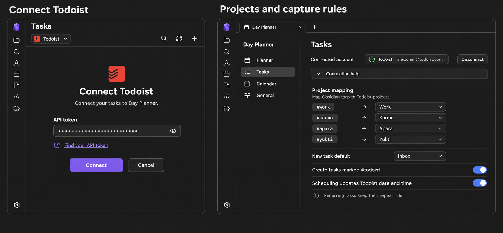
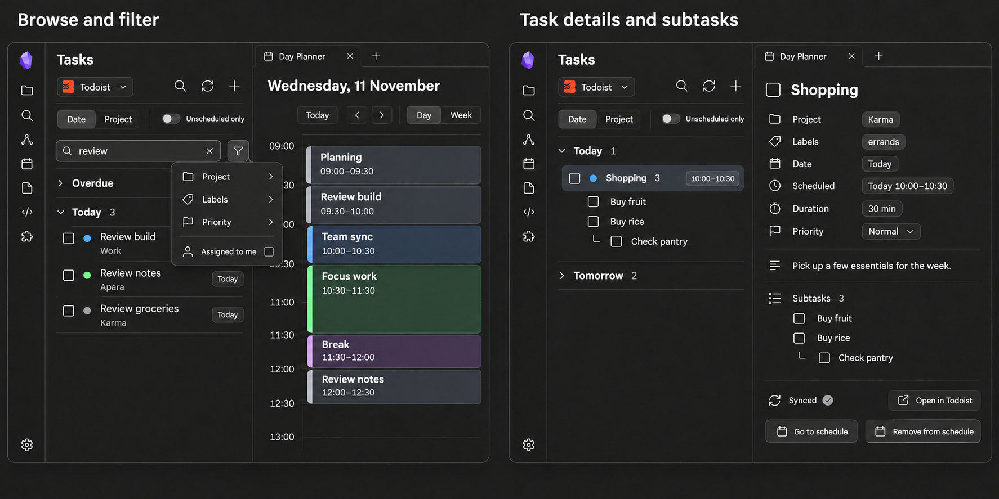
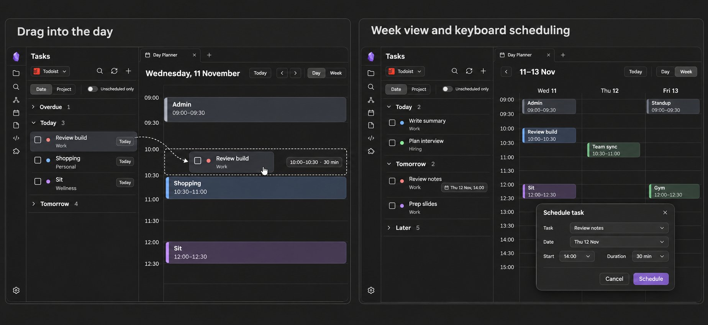
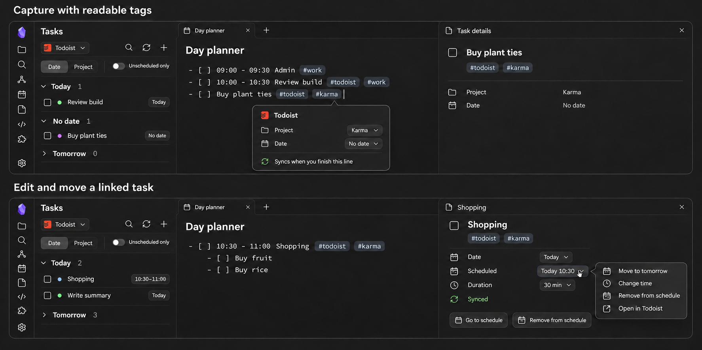
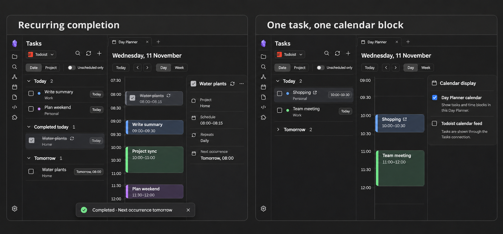
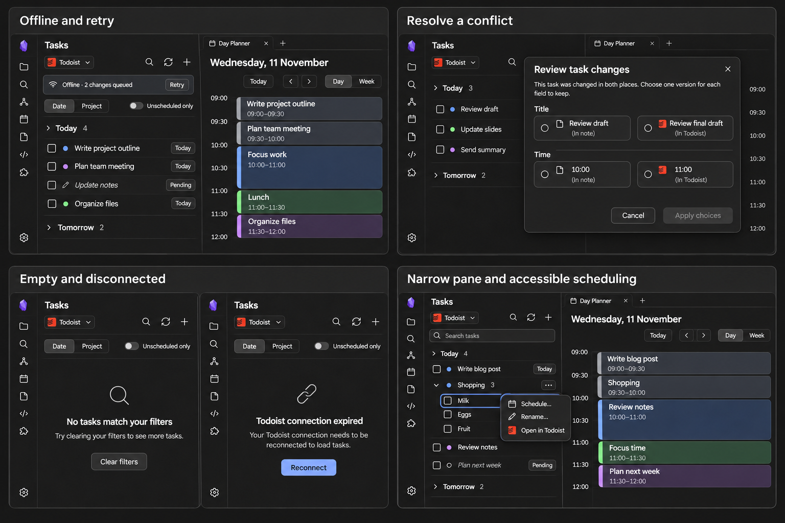
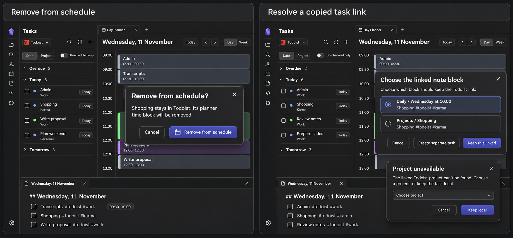
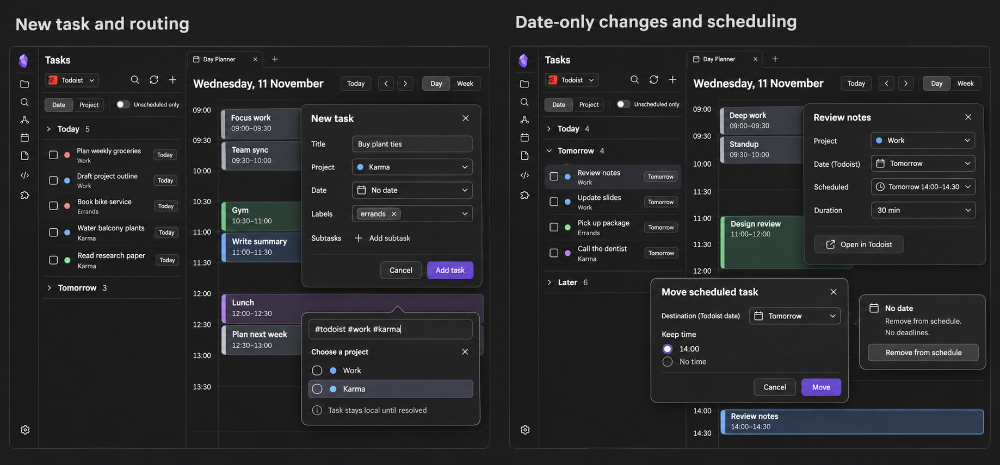

# Mockup gallery

The final boards illustrate the planned product. Read [the design review](../DESIGN-REVIEW.md) for the behavior they guide and the refinements made after generation.

| Board | Preview |
| --- | --- |
| Connect and map projects |  |
| Browse and edit details |  |
| Schedule in day and week |  |
| Capture and edit Markdown |  |
| Recurrence and one calendar block |  |
| Offline, conflict and narrow panes |  |
| Unschedule and repair links |  |
| Create tasks and change dates |  |

Prompts and targeted revisions are saved in [prompts.json](prompts.json). All final boards use synthetic task examples.
